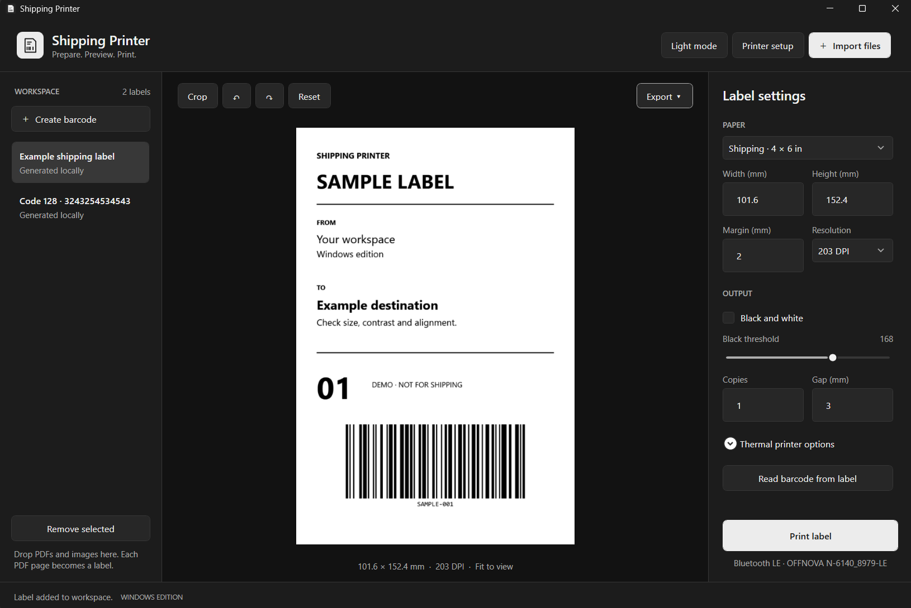

# Shipping Printer for Windows

Print shipping labels from PDFs and images, with support for Windows printer drivers and OFFNOVA N-6140 Bluetooth printing.

**[Download for Windows](https://github.com/Mxlted/shipping-printer-windows/releases/latest)** · [Printer setup](docs/printers.md) · [Report a bug](https://github.com/Mxlted/shipping-printer-windows/issues)



## Features

- Import PDFs and common image formats. Each PDF page becomes a label.
- Crop, rotate, and preview labels with adjustable paper size and margins.
- Create and read barcodes and QR codes.
- Export labels as PNG images.
- Select multiple labels, use keyboard shortcuts and right-click actions, and undo changes.
- Light and dark themes, with saved printer preferences.

## Get started

1. Download and run the **Setup.exe** from the [latest release](https://github.com/Mxlted/shipping-printer-windows/releases/latest).
2. Import a PDF or image and choose the paper size to match your labels.
3. Select your printer under **Destination**, check the preview, and choose **Print label**.

See the [printer guide](docs/printers.md) for OFFNOVA Bluetooth setup and troubleshooting.

Documents are processed locally, and original files stay unchanged. The workspace lasts for the current session, so export edits you want to keep before closing.

## Build from source

On Windows x64, install Git, PowerShell 7, and [.NET SDK 10.0.403](https://dotnet.microsoft.com/download/dotnet/10.0), then run:

```powershell
git clone https://github.com/Mxlted/shipping-printer-windows.git
cd shipping-printer-windows
pwsh ./scripts/build.ps1
dotnet run --project ./src/ShippingPrinter.Windows -c Release
```

The build script also runs the offline checks. See [Contributing](CONTRIBUTING.md) for further development details.

---

[Changelog](CHANGELOG.md) · [Contributing](CONTRIBUTING.md) · [MIT license](LICENSE) · [Third-party notices](THIRD-PARTY-NOTICES.md)

Independent project; not affiliated with Shiprinter, OFFNOVA, or AiYin.