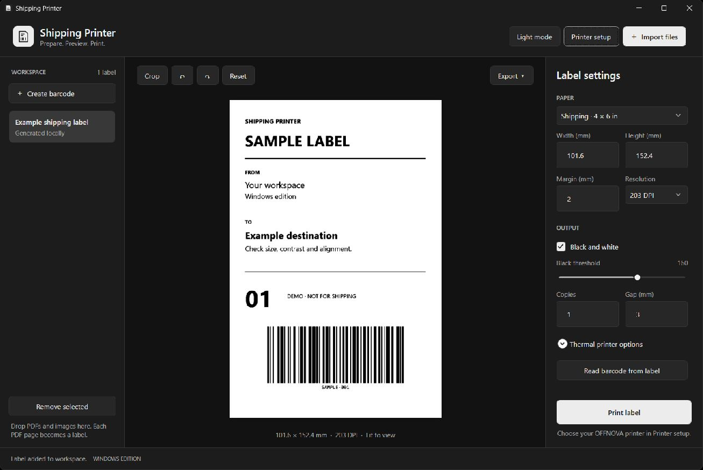

# Shipping Printer for Windows

Print shipping labels from a native Windows workspace, including wireless printing to the OFFNOVA N-6140. Import a PDF or image, adjust the label, and send it to your printer.

**[Download for Windows x64](https://github.com/Mxlted/shipping-printer-windows/releases/latest)** · [Printer setup](docs/printers.md) · [Changelog](CHANGELOG.md) · [Contributing](CONTRIBUTING.md)



## Get started

1. Download the Windows x64 ZIP from the [latest release](https://github.com/Mxlted/shipping-printer-windows/releases/latest).
2. Extract the entire folder and open `ShippingPrinter.exe`. The .NET runtime is included.
3. Import a PDF or image, or choose **Try an example label**.
4. Choose the paper size, open **Printer setup**, and select your printer.
5. Review the preview and choose **Print label**.

Windows 11 x64 is recommended. Releases are portable and currently unsigned. Keep all files in the extracted folder together. The app targets Windows 10 build 19041 or newer; older Windows versions have not been release-tested.

### OFFNOVA N-6140 over Bluetooth

Turn on the printer, keep it near the PC, and disconnect it from any phone app. In **Printer setup**, choose **OFFNOVA N-6140 · Bluetooth LE**, then **Find OFFNOVA printer**. Select the device ending in `-LE`, let the connection check finish, and choose **Use this printer**. Start with **203 DPI** and the paper size loaded in the printer.

The OFFNOVA BLE workflow is user-reported working. Hardware revisions can differ; Bluetooth Classic and other printer models still need device testing. See the [printer guide](docs/printers.md) for connection options and troubleshooting.

## What it does

- Imports PDFs, PNG, JPEG, BMP, TIFF, and GIF images. Each PDF page becomes a label.
- Crops and rotates labels, with adjustable paper size, margins, and black threshold.
- Creates QR, Code 128, Code 39, Code 93, EAN-13, UPC-A, ITF, and Data Matrix codes, and reads barcodes from imported images.
- Prints through an installed Windows driver, direct TSPL, or the dedicated OFFNOVA Bluetooth profiles.
- Exports the selected label as a PNG or printer command file.
- Remembers your printer, print settings, and light or neutral dark appearance.

**Print label** prints the selected item; **Copies** repeats that item. The workspace is a temporary session, so export any edits you want to keep before closing. Original files are never modified.

| Shortcut | Action |
| --- | --- |
| `Ctrl+O` | Import files |
| `Ctrl+P` | Print the selected label |
| `Ctrl+V` | Paste an image from the clipboard |

## Build from source

Use Windows x64, PowerShell 7, and the [.NET 10 SDK](https://dotnet.microsoft.com/download/dotnet/10.0) selected by `global.json` (10.0.402 or a later servicing patch). The first restore needs access to NuGet.

```powershell
git clone https://github.com/Mxlted/shipping-printer-windows.git
cd shipping-printer-windows
pwsh ./scripts/build.ps1
dotnet run --project ./src/ShippingPrinter.Windows -c Release
```

The build script restores locked dependencies, compiles the app, and runs the offline checks. Create a portable release with:

```powershell
pwsh ./scripts/package.ps1
```

The versioned ZIP and its SHA-256 checksum go to `dist/`. The checks exercise image and PDF handling, barcode round trips, settings, and printer payloads without discovering devices or sending print jobs. A passing check run does not establish compatibility with a particular printer.

The application is C# and WPF, with Windows PDF rendering and ZXing.Net for barcodes. Source lives in `src/`; the check runner is in `tests/`. Build outputs and local investigation files are excluded from the repository.

## Local data

Documents are processed on your PC. Printing sends label data to the selected printer or Windows queue; there is no account or cloud service.

Preferences are stored in `%LocalAppData%\ShippingPrinter.Windows\settings.json`. Set `SHIPPING_PRINTER_DATA` to another directory to use an isolated profile.

## Help and contributions

For connection problems, start with [Printer setup and troubleshooting](docs/printers.md). If you find a bug, [open an issue](https://github.com/Mxlted/shipping-printer-windows/issues) with the app version, Windows version, printer model, and connection type. Use a sample label with no personal information.

Improvements and printer compatibility reports are welcome. The [contribution guide](CONTRIBUTING.md) covers the build, checks, and information needed for a useful hardware report.

## License

[MIT](LICENSE). Third-party components retain their own licenses; see [THIRD-PARTY-NOTICES.md](THIRD-PARTY-NOTICES.md).

This is an independent project inspired by the Shipping Printer mobile workflow. It is not affiliated with Shiprinter, OFFNOVA, or AiYin. No original mobile application binaries, source, or assets are distributed here.
